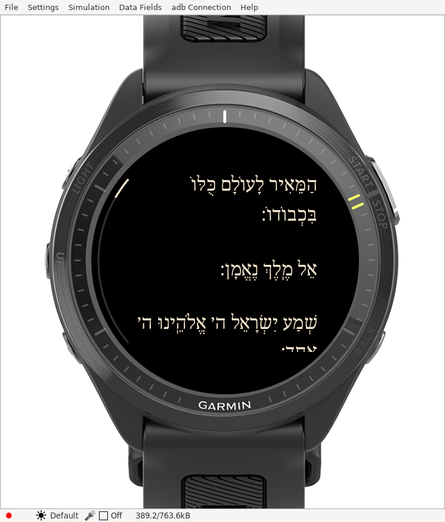
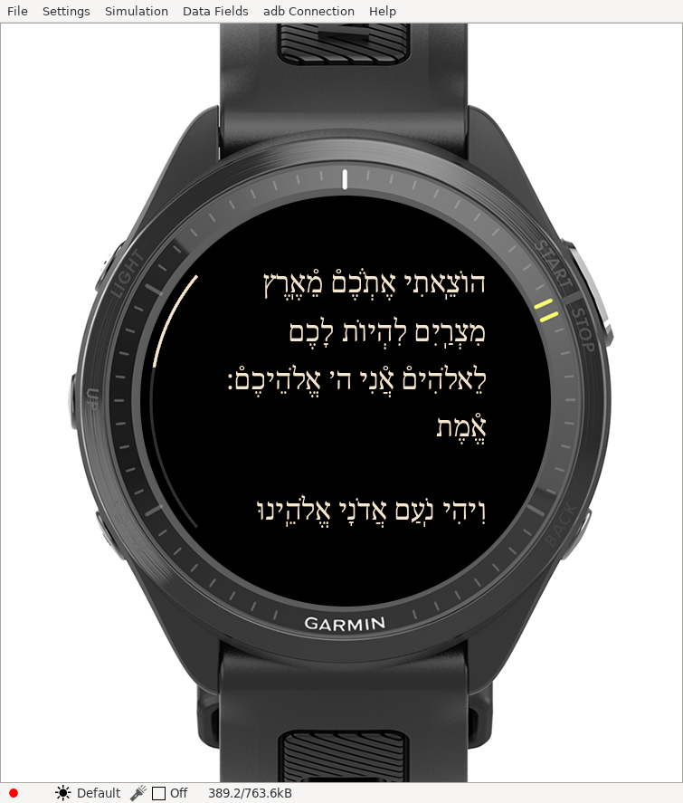
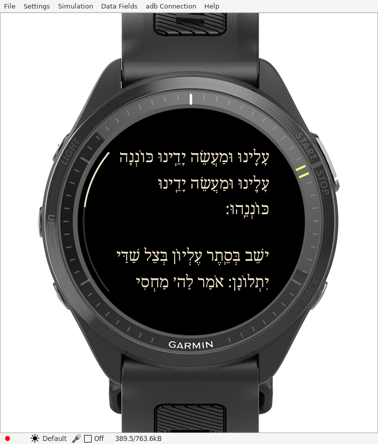

# Four-letter Name only

The final requested convention replaces **only the four-letter Name with ה׳**. Every other Name retains its exact original spelling, vowels, prefixes and endings. No kuf substitutions or extra dashes are applied. Earlier blanket-substitution evidence is historical and superseded.

There are **141 replacements**: 49 Ashkenaz, 65 Sefard and 27 Edot HaMizrach. Original source JSON is unchanged, and the [readable review text](../content/review/ashkenaz.md) now reflects this convention. The [span audit](DIVINE-NAMES.md) lists the current policy.

A full-corpus test independently replaces only the pointed four-letter sequence and checks that the resulting text matches the app's display input character for character. This also proves that every other word/Name is preserved. Word identities remain stable; saved positions from the earlier layout migrate by anchor using the new text version.

The SDK review build succeeds. All **33 host tests pass**, including every paragraph across all nine generated nusach/size layouts and unchanged source/word checks. Native results and actual simulator images are recorded below and in the accompanying evidence.

Brightness, progress, scrolling controls and settings navigation retain their latest behavior. This change resets the Name convention only. The abandoned five-rule version was never pushed or packaged for download.

[Download the corrected ZIP](../downloads/README.md).

## Actual simulator images

[Artifact hashes and verification](simulator/four-letter-only/evidence.json).

All **nine native tests report PASS**, covering reflowed layouts, word anchoring, saved-layout migration, visibility options and one-row overlap. The unchanged SDK client still exits 1 despite its zero-failure summary; the unmodified status and [raw output](simulator/four-letter-only/native-tests.txt) are retained separately. Physical-watch acceptance of this update remains to be checked.
