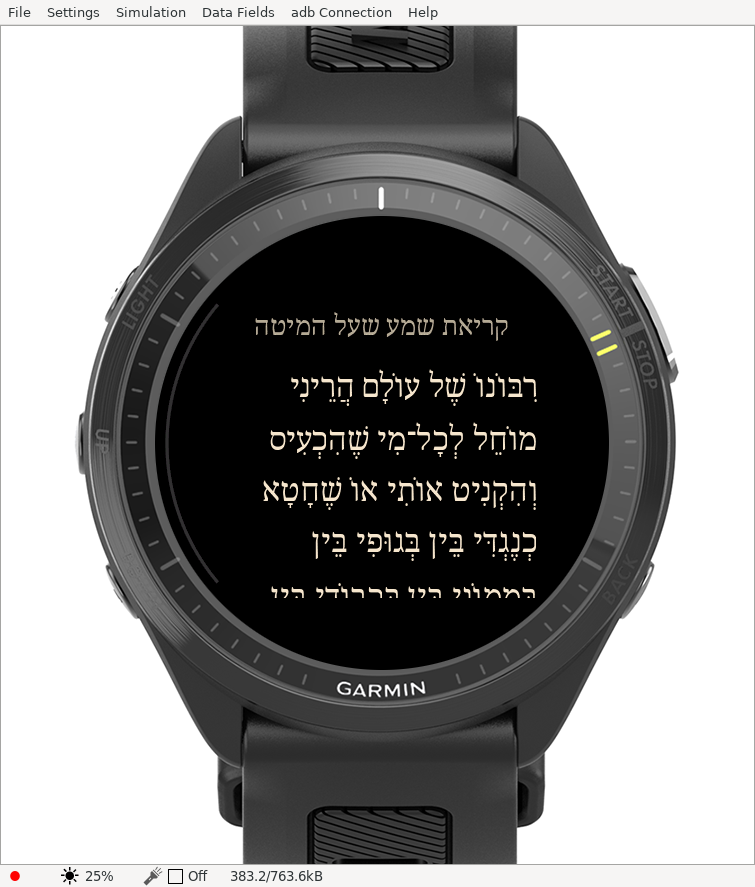
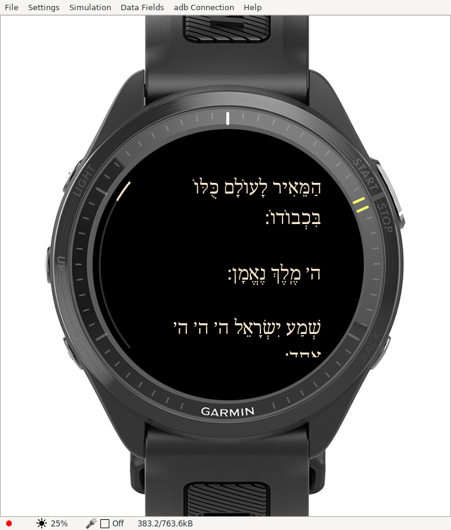
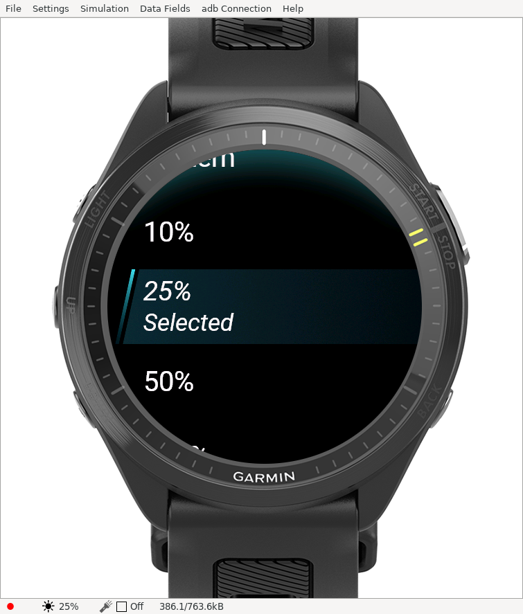

# Beginning, brightness and Divine Names — 2026-11-11

**Superseded Name convention:** the earlier blanket substitution described below has been corrected to the [four-letter-only convention](FOUR-LETTER-NAME.md). The brightness/beginning checks remain valid.

**Return to beginning** now closes settings and immediately displays the start of the selected document. Other selection menus retain their existing stay-open behavior.

**Brightness** appears beneath Text size and offers System, 10%, 25%, 50% and 100%. It is saved in preferences and applied on selection and reader entry using Garmin's supported `Attention.backlight` API. Garmin still controls timeout and burn-in protection. There is no repeating keep-awake timer. Actual physical-watch brightness behavior remains to be checked.

**Divine Names display as ה׳**, he followed by Hebrew geresh. The audited policy replaces 77 occurrences in Ashkenaz, 96 in Sefard and 50 in Edot: **223 total**. This includes Divine Name forms, not just the four-letter Name. Prefixes and unrelated wording/pointing remain intact. Prepositions/negations, angel names, descriptive words and the Shema reference to other gods remain unchanged. Original source JSON is retained verbatim; [displayed review text](../content/review/ashkenaz.md) and [the substitution audit](DIVINE-NAMES.md) reflect the app's convention.

Replacement spans are pinned to source text digests and validated before shaping. All nine nusach/size variants are regenerated. Replacements retain word identities; a new text-layout version causes older saved pixel positions to migrate by word anchor rather than using an obsolete offset.

## Verification

Both SDK builds succeed. **33 host tests pass**, including full-corpus substitution coverage, unchanged ordinary words, changed-source rejection, paragraph/word preservation and generated raster/resource checks. **All nine native tests report PASS**, including font anchoring, version migration, overlap and visibility variants. The unchanged SDK client still exits 1 despite its zero-failure summary; [raw output](simulator/names-brightness/native-tests.txt) and the unmodified status are retained in [evidence.json](simulator/names-brightness/evidence.json).

Actual simulator checks confirmed Return to beginning from offset 2,201 saves offset zero and closes the menu. An initial input sequence before the menu was established was excluded; the confirmed menu and resulting reader frames are retained. Brightness selected 25%, stayed in settings and the simulator's own status indicator changed to 25%. The displayed Shema was inspected for the he/geresh convention. Physical-watch update/brightness acceptance and editorial review remain open.

[Download the updated FR970 ZIP](../downloads/README.md). The package includes the change/substitution notices and license records. No environment publishing or store submission was performed.
