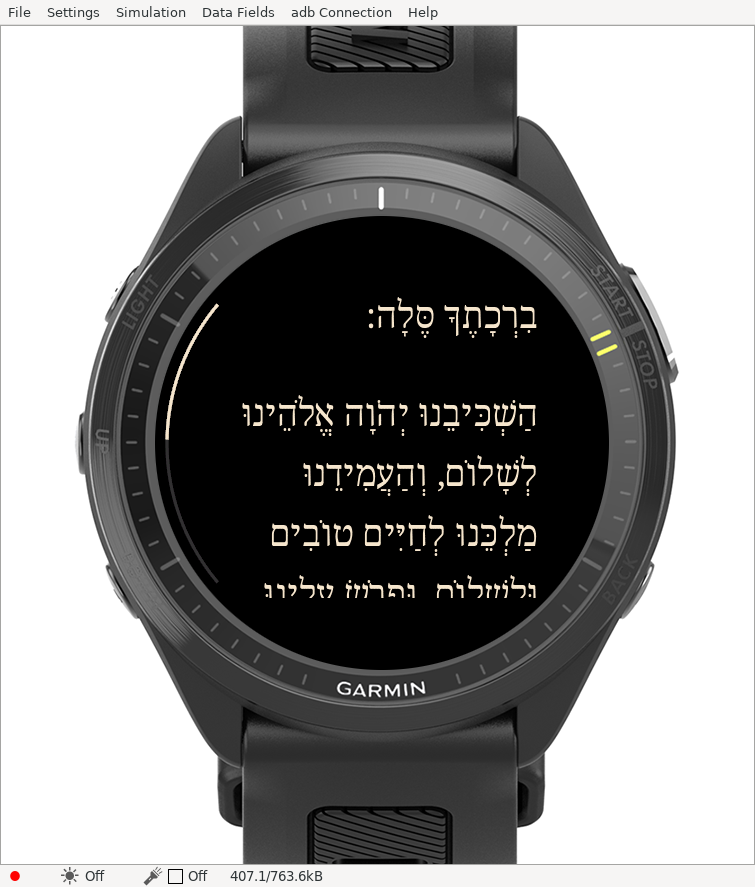
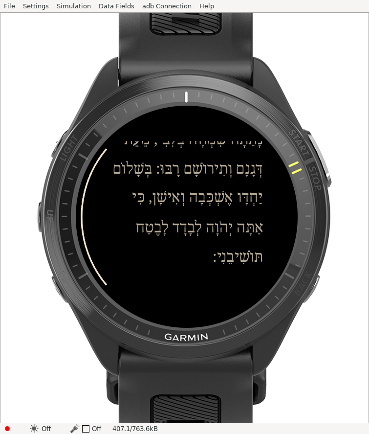
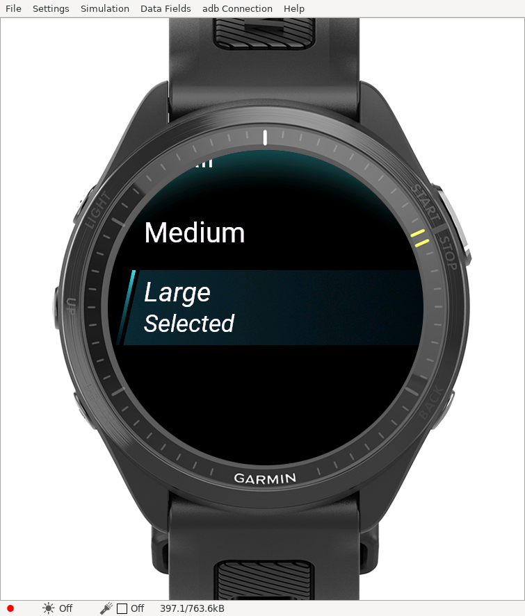
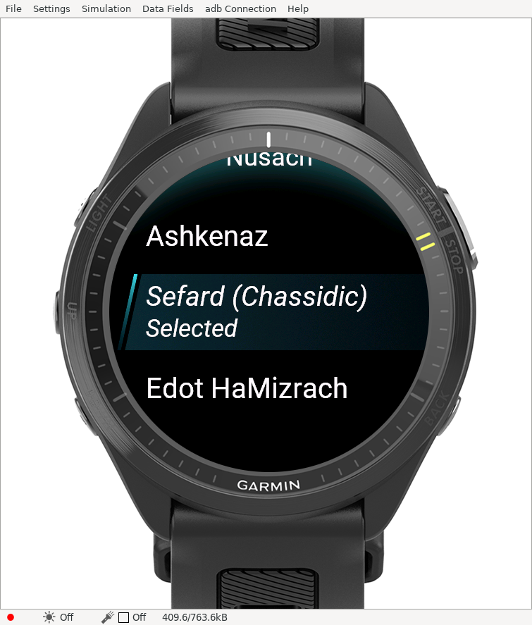

# Progress and settings update

The FR970 reader now shows a slim three-pixel progress arc along the left edge, outside the Hebrew text. A gray track fills in warm white as the current document advances. Its bounds reflect the chosen nusach, text size and visibility settings. No polling timer is needed.

Screen turns now repeat only the final visible line, including a partially visible row. The previous viewport-minus-line-height calculation rounded down again and repeated both a complete and a partial line. Backward screen steps put the first current line at the preceding screen's bottom. First/last screens still clamp to document bounds and may overlap extra rows there.

Settings selections remain in their current menu, with immediate subtitles and a Selected marker in font-size/nusach submenus. BACK returns to the parent menu, then to reading. Return to beginning now closes settings and opens the start of the document; other selections remain in settings. The explicit Close reader action and the reader's direct BACK exit remain available.

## Actual simulator checks

The SDK 9.3.0 normal and native-test builds compile successfully. Physical-button checks verified instruction toggles remain in the main menu; font and nusach selections remain in their submenus; parent subtitles update; and BACK returns one level. Two captured screen turns show only one common visible line.

An actual rendered traversal of Sefard at large size (instructions hidden) reached offset **23,420**, matching the filtered layout's maximum. The arc was inspected at the beginning, offset 11,540 (about 49%), and the end. This is one traversal, not prolonged rendered stress or physical-watch acceptance.

[First screen turn](simulator/progress-settings/progress-page-one.png) / [next screen turn](simulator/progress-settings/progress-page-two.png) / [toggle remains in settings](simulator/progress-settings/settings-toggle-stays.png).

**All nine native tests report PASS**, including exact shared-row counts across all nine nusach/size layouts and progress at both bounds and halfway. The unchanged SDK client still exits 1 despite its zero-failure summary; that status and [raw output](simulator/progress-settings/native-tests.txt) are retained.

Native results and artifact hashes are recorded in [evidence.json](simulator/progress-settings/evidence.json). The earlier 29 host-test checkpoint remains in reader-options evidence; this update changes Monkey C behavior and package notes, with native and actual simulator verification.

[Download the updated FR970 ZIP](../downloads/README.md). Source review and release gates remain open. No environment publishing or store submission is involved.
