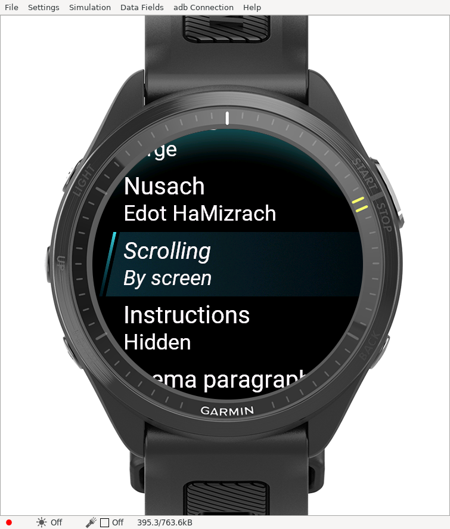
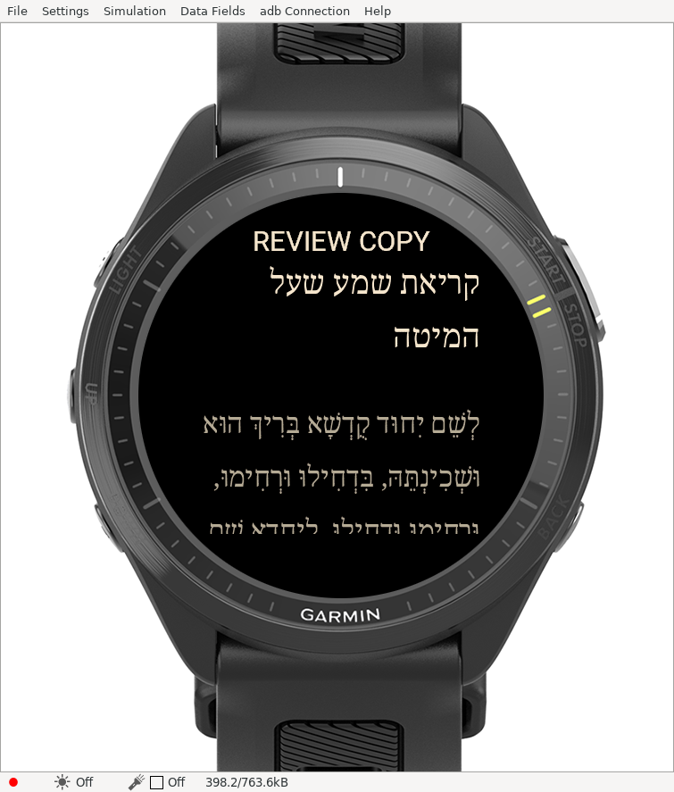
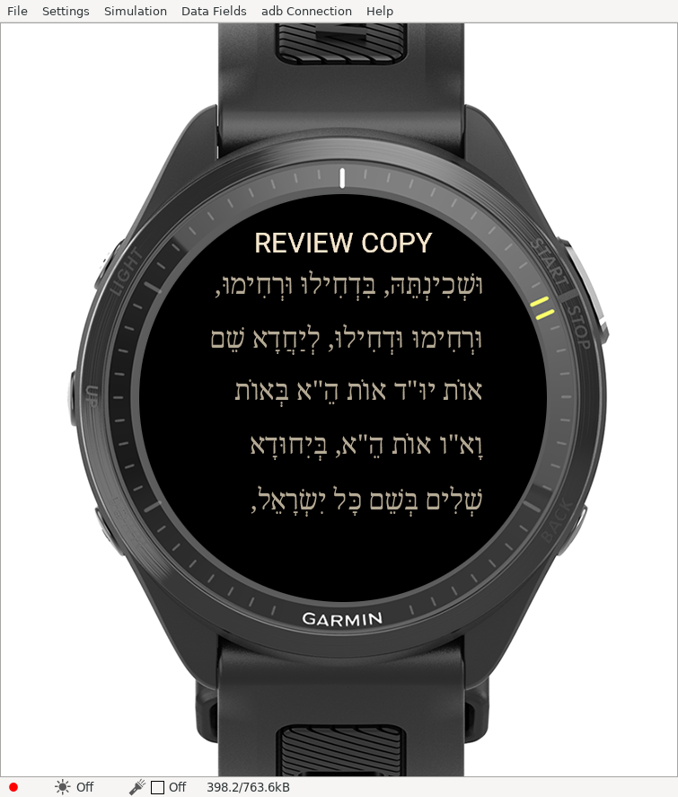
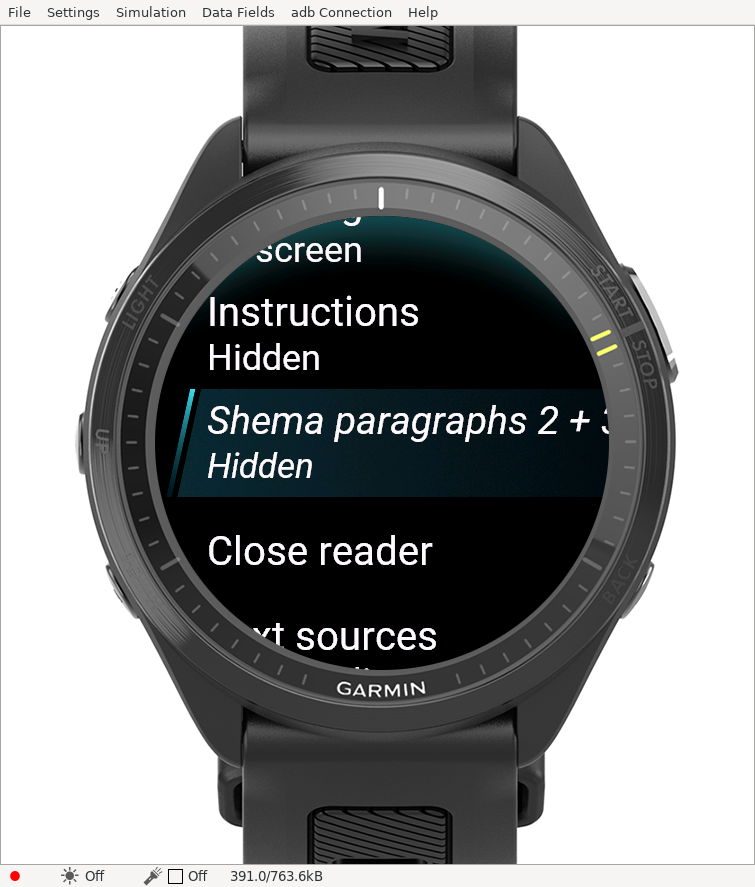

# Reader controls update — 2026-11-10

The FR970 review build now addresses the first physical-watch feedback:

- **Scrolling defaults to By screen.** Up/down, select/back and swipe advance immediately by a screen step aligned to complete lines, retaining a line of context. There is no slow animation or queued movement. Choose By line for smaller immediate steps; touch dragging remains continuous.
- **Instructions default to Hidden.** The Instructions setting toggles source directions and their editorial labels. Conditional prayer passages and prayer text printed small in the source remain included. Original source assets remain bundled and unchanged.
- **Shema 2 + 3** toggles the second and third passages together. They default to Shown. The mapping covers Ashkenaz blocks 8–9, Sefard 7–8 and Edot 12–14, including Edot's separately printed closing repetition. The first passage remains visible.

Hold the middle-left UP/MENU button to open settings. Visibility and scroll settings persist. Hiding passages compacts their spacing. Saved positions record the active layout; positions from the earlier app migrate by word anchor when the visibility defaults change.

[Download the updated review ZIP](../downloads/README.md). Close the existing app before transferring the extracted PRG to `GARMIN/APPS` using the same process as the first installation. Application ID and development signing key remain the same. Physical-watch update acceptance is pending; this remains a review copy.

## Verification

Both normal review and native-test builds compile successfully with SDK 9.3.0. All **29 host tests pass**. All **seven native tests report PASS**, including the four existing checks, visibility combinations across nine layouts, immediate forward/backward screen steps to both bounds, line steps and legacy-position/hidden-passage anchoring. The SDK client still exits 1 despite its zero-failure summary; that status is retained in [evidence](simulator/reader-options/evidence.json), and [raw output](simulator/reader-options/native-tests.txt) is included.

Actual simulator checks toggled instructions, advanced a screen using select and changed Shema visibility. These are distinct from state-only traversal tests; long rendered stress testing is not claimed.

Source review, abbreviated Edot text and other limits in [the original review report](REVIEW-BUILD.md) remain open. Font and source licenses accompany the download. No environment publishing or store submission is involved.
