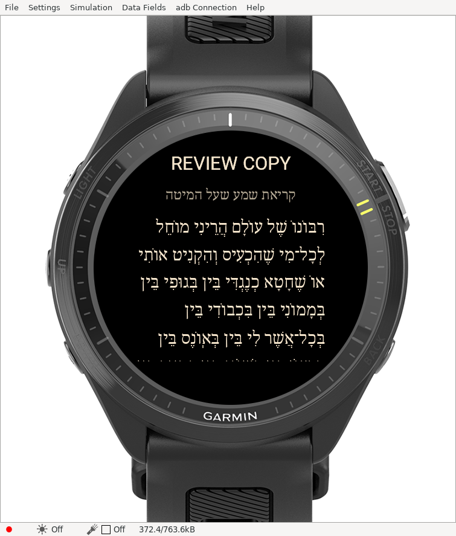
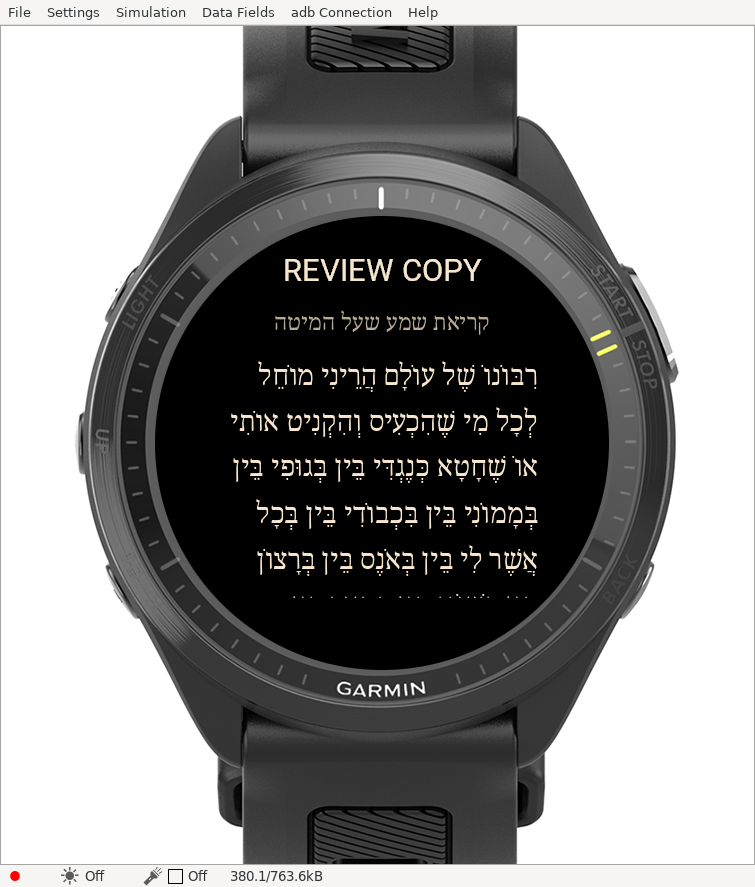
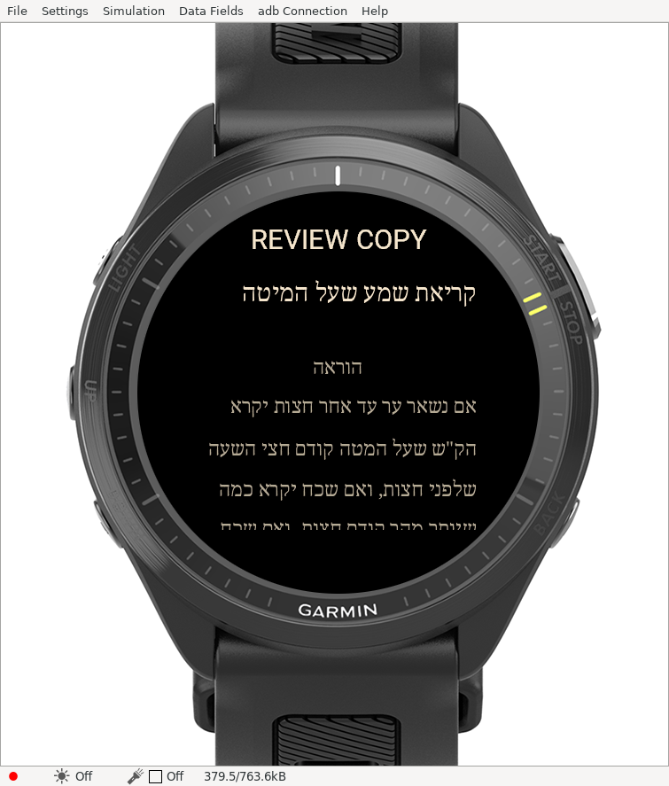

# FR970 source-review build — 2026-11-09

**Updated 2026-11-10:** [new reading controls, current tests and screenshots](READER-OPTIONS.md). The report below records the original integration checkpoint.

All three acquired source sequences are included in one offline FR970 build, at three font sizes. This is marked **REVIEW COPY**. Release approval is still blocked; Venu 2 is excluded at the user's request.

## Read the text

- [Ashkenaz: 37 source blocks](../content/review/ashkenaz.md)
- [Sefard: 27 source blocks](../content/review/sefard.md)
- [Edot HaMizrach: 30 source blocks](../content/review/edot_hamizrach.md)

These readable Markdown files mirror the review documents under `content/nuschaot/`. They are review material, not certification of liturgical completeness. Exact source HTML, source hashes and license evidence remain under `content/acquired/`. Display preparation removes HTML presentation tags, decodes entities, collapses whitespace and distinguishes instructions/conditional material; it preserves Hebrew wording, vowels, punctuation and source order. All 94 blocks are retained and tested against their sources. Editorial labels are separate from source paragraphs.

The selected Edot source abbreviates Yoshev Beseter; no verses were borrowed to fill it. Weekday/Shabbat alternatives, divine-name conventions, conditional instructions and source appendices remain as supplied and require knowledgeable review. Preparation and review generation never mark content verified.

## Actual simulator images

These are captures from SDK 9.3.0 running the uploaded FR970 package, not host-generated mockups.

### Ashkenaz

### Sefard

### Edot HaMizrach

[Edot after touch scrolling](simulator/review/edot-scrolled.png) shows an intermediate position, not the document end.

## Build and verification

The local artifact is `build/fr970.review.prg` (about 5.2 MB). It is ignored by Git; [build commands](INSTALL.md) reproduce it. Checksums and exact byte counts are in [evidence.json](simulator/review/evidence.json).

All nine layouts fit in 1,356 deduplicated two-line bitmap resources, below the SDK's 2,047-resource ceiling. Lossless bitmap compression is enabled. Ordinary bitmap drawing with destination clipping handles the indexed images; indexed source cropping through drawBitmap2 was rejected by this SDK and removed. Visible atlas estimates remain below 128 KB; VM status samples during document switching were approximately 372–380 KB of the displayed 763.6 KB budget. These samples do not prove absence of a leak or physical-watch acceptance.

**28 host tests pass**, including all-block source fidelity, instruction classification, release gates and raster-to-atlas comparisons across all nine layouts. **Four native tests report PASS**: bounds, section boundaries, font word anchoring and three state traversals in each direction for each of nine layouts. State traversal tests do not constitute rendered stress testing. [Raw native output](simulator/review/native-tests.txt) is retained. The unchanged SDK client exits **1** despite `PASSED (passed=4, failed=0, errors=0)`; this known anomaly is recorded separately.

Actual UI checks opened all three documents, scrolled Edot and recorded a small-to-large anchor relocation from offset 854 to 1416. Offline attribution and review notes are compiled into Text sources; visual verification of that screen remains pending. Historical prototype size/resume checks are in [FR970-VALIDATION.md](FR970-VALIDATION.md).

Compiler typing/icon warnings remain. Native-font comparison, prolonged rendered stress, physical-watch behavior, session expiry and update acceptance are not claimed complete. No release/store package or environment publication was performed.
